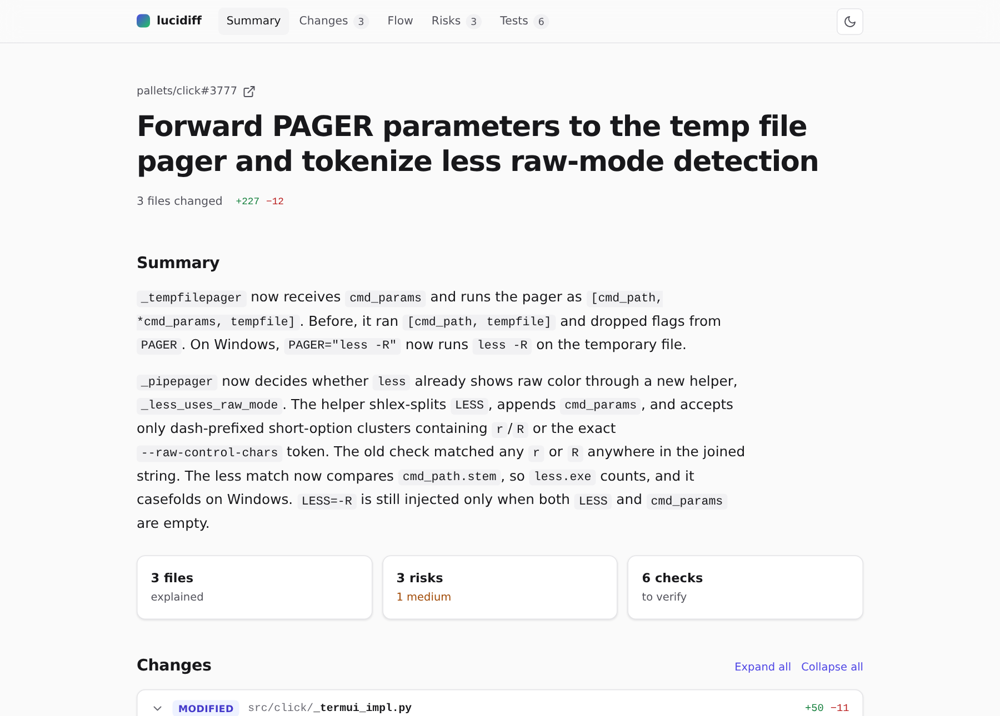
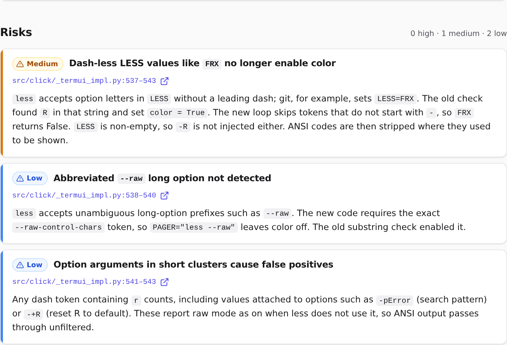

# lucidiff

**Turn a pull request into a self-contained, interactive HTML page that explains what changed, how it flows, what is risky, and what to test.**

[](https://github.com/Rishabjs03/pr-karpathy/actions/workflows/ci.yml)
[](LICENSE)

<picture>
  <source media="(prefers-color-scheme: dark)" srcset="docs/images/explainer-dark.png">
  
</picture>

As AI agents write more of the code, the human job shifts from writing code to understanding
and reviewing it. lucidiff reads a PR and writes one HTML file a reviewer can read in a few
minutes:

- **Summary**: what the PR does and why, in plain technical English.
- **Changes**: one card per file: what changed and why it matters.
- **Flow**: a diagram of how the changed parts connect.
- **Risks**: each with a severity, a file and line range that links to the PR, and the concrete
  failure mechanism. Every citation is checked against the diff.
- **Test checklist**: specific checks to run, with checkboxes that remember their state.

The model never writes HTML. It fills a JSON schema; lucidiff validates the JSON, checks every
citation, and renders a fixed, accessible template.

## Quick start

You need Node.js 22.12 or later and an API key for Anthropic, OpenAI, or the Vercel AI Gateway.

```sh
export ANTHROPIC_API_KEY=sk-ant-...        # or OPENAI_API_KEY, or AI_GATEWAY_API_KEY
npx lucidiff https://github.com/pallets/click/pull/3777 --open
```

That's it: lucidiff fetches the PR, writes `pallets-click-3777.explainer.html`, and opens it.
For private repositories, also set `GITHUB_TOKEN`.

> **Before the first npm release**, run it from source:
>
> ```sh
> git clone https://github.com/Rishabjs03/pr-karpathy.git && cd pr-karpathy
> pnpm install && pnpm build
> node packages/cli/dist/bin.js https://github.com/pallets/click/pull/3777 --open
> ```

## Examples

The [`examples/`](examples/) folder has explainers for three real pull requests, committed so
you can see the output without running anything. Download an `index.html` and open it in a
browser.

| Example                                                        | PR                                                                 | What it shows                                                                        |
| -------------------------------------------------------------- | ------------------------------------------------------------------ | ------------------------------------------------------------------------------------ |
| [`ky-880-signal-replace`](examples/ky-880-signal-replace/)     | [sindresorhus/ky#880](https://github.com/sindresorhus/ky/pull/880) | A small fix (4 files) where the explainer finds a regression for `signal: undefined` |
| [`click-3777-pager-params`](examples/click-3777-pager-params/) | [pallets/click#3777](https://github.com/pallets/click/pull/3777)   | A Python change where the explainer finds a color regression for `LESS=FRX`          |
| [`ky-842-network-error`](examples/ky-842-network-error/)       | [sindresorhus/ky#842](https://github.com/sindresorhus/ky/pull/842) | A 15-file feature with a breaking change, flow diagram, and seven checks             |

The answers come from live runs of the CLI against `claude-opus-5-5`. See
[`examples/README.md`](examples/README.md) for how they were made.

<p align="center">
  
</p>

## Usage

```sh
lucidiff https://github.com/owner/repo/pull/123        # a GitHub PR (also: owner/repo#123)
lucidiff --git main...feature-branch                    # a local git range (what a PR would show)
lucidiff --git                                          # your uncommitted changes
git diff | lucidiff --stdin                             # any unified diff on stdin
lucidiff changes.patch -o review.html --open            # a diff or patch file
lucidiff owner/repo#123 --json > explainer.json         # the validated JSON instead of HTML
lucidiff render explainer.json --open                   # render saved JSON to HTML
```

| Flag                     | Description                                                                                         |
| ------------------------ | --------------------------------------------------------------------------------------------------- |
| `-o, --output <file>`    | Output file. Default: `<source>.explainer.html` (or `explainer.html` for stdin).                    |
| `--open`                 | Open the result in your browser.                                                                    |
| `--json`                 | Write the explainer JSON instead of HTML, to stdout unless `-o` is set.                             |
| `--git [range]`          | Explain a local git range: `<ref>`, `<a>..<b>`, or `<a>...<b>`. No range means uncommitted changes. |
| `--stdin`                | Read a unified diff from stdin. lucidiff also reads stdin when it is piped and no input is given.   |
| `--provider <name>`      | `anthropic`, `openai`, or `gateway`. Default: the first one with a key set.                         |
| `--model <id>`           | Model id. Defaults: `claude-opus-5-5`, `gpt-5.5`, `anthropic/claude-opus-5-5`.                      |
| `--effort <level>`       | `low`, `medium`, or `high` reasoning effort, for models that support it.                            |
| `--offline`              | Embed Mermaid in the page (about 5 MB) so it works without network access.                          |
| `--no-context`           | Send only the diff, not the full contents of changed files.                                         |
| `--ignore <glob>`        | Skip matching files. Repeatable. Adds to the default ignore list.                                   |
| `--include <glob>`       | Always analyze matching files, even if an ignore pattern matches. Repeatable.                       |
| `--no-default-ignores`   | Do not skip lockfiles, build output, and minified or generated files.                               |
| `--no-redact`            | Do not redact likely secrets before sending. Not recommended.                                       |
| `--max-input-tokens <n>` | Token budget for one model call. Larger PRs are split into batches. Default 150,000.                |
| `--verbose`              | Print debug details: redaction counts, dropped risks with reasons, raw model output.                |

lucidiff shows a progress line per stage (on stderr, so `--json` output stays clean) and
prints the token usage at the end. This is a live run on the diff of one of the
[examples](#examples) (timings and token counts vary by PR and model):

```
$ lucidiff examples/click-3777-pager-params/pr.diff -o .sample/live/click-3777-pager-params.html
✔ Loading changes pr.diff: 3 files 0.0s
✔ Filtering and redacting 3 files to analyze, 0 skipped, 0 secrets redacted 0.0s
✔ Analyzing with claude-opus-5-5 1 model call 36.6s
✔ Validating citations and diagram 3 risks, 6 checks 0.4s
✔ Rendering HTML .sample/live/click-3777-pager-params.html 0.1s
Tokens: 11,119 input · 3,521 output · 1 model call (claude-opus-5-5)
```

## Library usage

The pipeline (`@lucidiff/core`) and the renderer (`@lucidiff/renderer`) are separate packages
with typed APIs, so you can build your own integrations.

```ts
import { explain } from '@lucidiff/core';
import { renderHtml } from '@lucidiff/renderer';

const { document, droppedRisks, warnings } = await explain(
  { kind: 'github', url: 'https://github.com/owner/repo/pull/123' },
  {
    provider: 'anthropic', // or pass any AI SDK model: { model: openai('gpt-5.5') }
    onProgress: (event) => console.error(event.stage, event.message),
  },
);

const html = renderHtml(document); // a complete, self-contained HTML page
```

Inputs are `{ kind: 'github', url }`, `{ kind: 'git', range, cwd }`, `{ kind: 'diff', diff }`,
or `{ kind: 'loaded', loaded }` to bring your own diff and metadata (for bots and other code
hosts). The returned `document` matches `ExplainerDocumentSchema`, a versioned Zod schema you
can import from `@lucidiff/core/schema`.

## Configuration

lucidiff reads these environment variables, and also reads them from a `.env` file in the
current directory (only these names; the rest of the file is ignored). See
[`.env.example`](.env.example).

| Variable                                                    | Purpose                                                                                            |
| ----------------------------------------------------------- | -------------------------------------------------------------------------------------------------- |
| `ANTHROPIC_API_KEY`, `OPENAI_API_KEY`, `AI_GATEWAY_API_KEY` | Provider credentials. Set at least one.                                                            |
| `LUCIDIFF_PROVIDER`, `LUCIDIFF_MODEL`                       | Defaults for `--provider` and `--model`.                                                           |
| `ANTHROPIC_BASE_URL`, `OPENAI_BASE_URL`                     | Custom API endpoints (proxies, compatible servers).                                                |
| `GITHUB_TOKEN`                                              | Private repositories and a higher rate limit. Read access to contents and pull requests is enough. |
| `GITHUB_API_URL`                                            | GitHub Enterprise Server API URL. Defaults to `https://<host>/api/v3` for non-github.com URLs.     |
| `LUCIDIFF_PLAIN_OUTPUT=1`                                   | No spinners or colors, for CI logs.                                                                |

**Default ignore list.** Lockfiles (`pnpm-lock.yaml`, `package-lock.json`, `go.sum`, `*.lock`,
...), build output (`dist/`, `build/`, `vendor/`, `node_modules/`), minified and generated
files (`*.min.js`, `*.map`, `*.pb.go`, files marked `@generated` or `DO NOT EDIT`),
snapshots, and binaries are not sent to the model. The explainer lists them under "files not
sent to the model", so you know to review them yourself.

## How it works

```
input → fetch diff + file contents → filter → redact secrets → plan token budget
      → model (structured JSON) → validate citations and flow → document → HTML
```

**The model never writes HTML or diagram syntax.** It returns JSON that matches a Zod schema
through structured output. The flow diagram is a list of nodes and edges, which lucidiff
compiles to Mermaid, so labels can never break the syntax and every diagram uses the same
visual language.

**Context, not just the diff.** For GitHub PRs and git ranges, lucidiff sends the full old and
new versions of changed files (old versions are read at the merge base, so line numbers match
the PR). The model sees a numbered diff, so it can cite exact lines.

**Every risk must cite a file and a line range, and the citation is checked.** A risk is
dropped when its file is not in the PR, its lines fall outside the changed hunks (plus a
5-line margin), its range spans more than 80 lines, or its reason is too short to describe a
mechanism. The footer shows how many risks were dropped; `--verbose` shows why.

**No invented concerns.** The prompt tells the model that zero risks is a valid answer and
that padding is worse than omission. Style preferences, naming, and "consider adding tests"
are not risks.

**Flow validation with one repair.** If the graph has dangling edges, duplicate ids, or too
many nodes (or Mermaid rejects the compiled source, when the optional `mermaid` package is
installed), lucidiff sends the exact errors back to the model once. If the repaired graph still
fails, the page shows a plain list of components and connections instead of a broken diagram.

**Large PRs.** When the numbered diff does not fit the token budget, lucidiff splits the files
into batches (splitting very large files by hunks), explains each batch, and runs one combining
call for the title, summary, flow, and checklist. Risks always come from calls that saw the
code.

The prompts live in [`packages/core/src/prompts/`](packages/core/src/prompts/), with the reason
for each rule written next to it.

## Writing style

The model writes in near [Simplified Technical English](https://www.asd-ste100.org/): active
voice, one idea per sentence, sentences under 20 words, paragraphs under 5 sentences, one word
for one meaning, no hedging or marketing words, and the real name of the function or file
instead of "this logic". The rules are in
[`packages/core/src/prompts/style.ts`](packages/core/src/prompts/style.ts).

## The page

- One self-contained file: inline CSS and JS, no external requests except a pinned Mermaid
  build from jsDelivr with a Subresource Integrity hash (or none with `--offline`).
- A strict Content Security Policy: only scripts with known hashes run.
- Light and dark mode, following the system setting, with a toggle.
- Sticky section navigation, collapsible change cards, risks sorted high to low with links to
  the exact PR lines, and a checklist saved in `localStorage` per PR.
- Semantic HTML, keyboard navigation, WCAG AA contrast, and print styles.

## Privacy and security

> **lucidiff sends your code to the LLM provider you configure.** For GitHub PRs and git
> ranges, that includes the full contents of changed files, not just the diff. Check your
> provider's data policy before you use lucidiff on private code.

- Likely secrets are redacted before anything is sent: API keys and tokens in known formats
  (Anthropic, OpenAI, GitHub, AWS, Google, Slack, Stripe, npm, and more), private key blocks,
  passwords in URLs, quoted values assigned to names like `password` or `api_key`, and every
  value in `.env` files. Test fixtures such as `token: 'valid-token'` or `apiKey: 'secret123'`
  are left alone. The count is printed and shown in the page footer. Redaction is a
  best-effort filter, not a guarantee.
- Skipped files (lockfiles, binaries, generated files) are never read or sent.
- Tokens and API keys are never logged. Raw model output is printed only with `--verbose`.
- The generated page escapes all text and runs under a strict CSP, so content from a PR cannot
  run as script.
- PR text and code are passed to the model as data, and the prompt tells it to ignore
  instructions inside them. Prompt injection can still change the content of an explainer;
  treat it as a reading aid, not an approval.

Report security issues privately; see [SECURITY.md](SECURITY.md).

## Repository layout

| Package                                                         | Description                                                |
| --------------------------------------------------------------- | ---------------------------------------------------------- |
| [`packages/core`](packages/core) (`@lucidiff/core`)             | Pipeline, schemas, sources, prompts, LLM calls, validation |
| [`packages/renderer`](packages/renderer) (`@lucidiff/renderer`) | Explainer document → self-contained HTML                   |
| [`packages/cli`](packages/cli) (`lucidiff`)                     | The command-line interface                                 |

## Roadmap

- [x] Schema, renderer, and design
- [x] Raw diff input, structured output, citation validation, flow repair and fallback
- [x] GitHub PRs with full-file context, local git ranges, ignore lists, secret redaction
- [x] Large PRs: batched analysis with a combining pass
- [x] Examples, README, and release workflow
- [ ] GitHub Action that posts the explainer as a PR comment and workflow artifact
- [ ] Webhook mode: other bots (for example a Slack PR triage bot) request an explainer and get
      a hosted link
- [ ] A config file (`lucidiff.config.json`) for team defaults
- [ ] GitLab and Bitbucket merge request sources

## Contributing

Contributions are welcome. Read [CONTRIBUTING.md](CONTRIBUTING.md) for the setup, the
architecture rules, and how to work on the design and the prompts. This project follows the
[Code of Conduct](CODE_OF_CONDUCT.md).

## License

[MIT](LICENSE)
